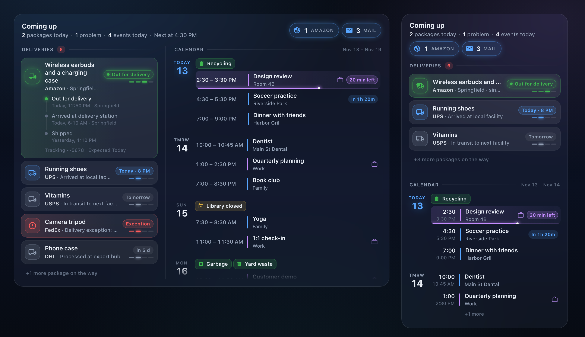

# Glasshouse Agenda Card

"What's coming" for a Home Assistant dashboard: **today's deliveries** and **the week ahead** from your
calendars, in one dense card. It replaces a parcel-tracker card and a week-planner card. Part of the
**Glasshouse** suite: refined dark glass, one accent per kind of thing, live numbers.



## Features

- **Deliveries** from a parcel sensor (built for the parcelapp integration, but forgiving about the data):
  a status pill (*Out for delivery* glows, *Today · 8 PM*, *Tomorrow*, *in 5 d*, *Exception* / *Failed
  attempt* in alert red), the description, carrier plus latest event, and a small 4-step progress bar
  (info → transit → out → delivered). Out-for-delivery first, then by days to delivery.
- **Tap a delivery** to expand its tracking timeline inline. Hold opens the sensor's more-info. Only
  the last 4 characters of a tracking number are ever shown.
- **Calendar**: several calendars merged and grouped by day (Today, Tomorrow, then "Sun 15") with a
  date column. All-day events are compact coloured pills (multi-day events show `2/3`); timed events
  are rows with time, a colour bar, summary and location. The running event gets a live progress line
  and "20 min left", the next one today a countdown. Ended events and empty days are skipped.
- **Counts strip**: optional chips in the header for carrier counts (e.g. Amazon today, mail pieces).
- **Header summary**: "2 packages today · 1 problem · 4 events today · Next at 4:30 PM".
- **Sizes to its content.** On cards 640 px wide or more it splits: deliveries (~40 %) | calendar
  (~60 %), and the calendar scrolls inside the deliveries' height (min 260 px) instead of leaving
  blank space. With no deliveries the calendar takes the full width (two columns of days when wide);
  an empty week becomes one compact line.
- Refreshes calendars every 15 min, on reconnect and at midnight. Each calendar is fetched and cached
  separately: one failing calendar shows a small note and never breaks the others.
- 12/24-hour time from your Home Assistant profile (`hass.locale`). Reduced-motion aware.

## Installation

### HACS (custom repository)

1. HACS → ⋮ → **Custom repositories**.
2. Add `https://github.com/petergCA/glasshouse-agenda-card` with type **Dashboard**.
3. Install **Glasshouse Agenda Card**, then reload the browser.

### Manual

1. Copy `glasshouse-agenda-card.js` to `config/www/`.
2. Settings → Dashboards → ⋮ → **Resources** → add `/local/glasshouse-agenda-card.js` as a
   **JavaScript module**.

For the full look, pair it with the **Glasshouse** theme.

## Configuration

| Option | Type | Default | Description |
|---|---|---|---|
| `type` | string | **required** | `custom:glasshouse-agenda-card` |
| `title` | string or `false` | `Coming up` | Header title. `false` hides it (the counts strip stays). |
| `days` | number | `7` | How many days of calendar, starting today (1–31). |
| `event_days` | number | – | Show the first N days **that have events** within the `days` look-ahead (e.g. `days: 14, event_days: 5` = the next five days with something on). |
| `max_events` | number | `14` | Cap across all days. Capped days show "+N more"; later days a single "+N more events through …" line. |
| `calendars` | list | – | Calendar entities (below). A plain entity id also works. |
| `deliveries` | object or string | – | The delivery sensor (below). |
| `counts` | list | – | Chips in the header strip (below). |
| `layout` | string | `auto` | `auto` (split when the card is ≥ 640 px wide), `stacked`, or `split`. |

At least one of `calendars`, `deliveries` or `counts` is required.

### Calendars

| Option | Default | Description |
|---|---|---|
| `entity` | **required** | A `calendar.*` entity. |
| `color` | palette | A Glasshouse accent (`info`, `ok`, `warn`, `alert`, `media`, `light`, `heat`, `cool`, `fan`, `cover`, `switch`, `lock`, `security`, `energy`, `water`, `neutral`) or any CSS colour. |
| `icon` | – | Optional icon shown on that calendar's pills and rows. |
| `name` | friendly name | Used in the "unavailable" note and as the row subtitle when an event has no location. |

### Deliveries

| Option | Default | Description |
|---|---|---|
| `entity` | **required** | Sensor whose attribute holds the list of deliveries. |
| `attribute` | `deliveries` | Attribute name. A list, an object map or a JSON string are accepted. |
| `show_delivered` | `false` | Also list delivered parcels (dimmed, last). |
| `max` | `4` | How many to show; the rest become "+N more packages on the way". |
| `default_view` | – | `today` or `all`. When set, a **Today / All** switch (with counts) sits at the right of the header; `today` lists only parcels due or out for delivery today, with a link to the rest. Without it, all parcels show and there is no switch. |
| `carrier_icons` | – | Carrier logos instead of the status icon: `parcelapp` uses the logos the [ParcelApp integration](https://github.com/petergCA/parcelapp) serves at `/parcelapp/images/` (UPS, USPS, FedEx, Amazon, OnTrac, …; unknown carriers get a box, delivered parcels a check). Or a map of `carrier_code: image URL` (with an optional `default`). A logo that fails to load falls back to the status icon. |

Each delivery may have (all optional): `description`, `carrier_code`, `status_code`, `date_expected`
(`YYYY-MM-DD HH:MM:SS`, local time), `days_to_delivery`, `latest_event`, `delivered`, `tracking_number`,
`events: [{event, date, location}]`.

`status_code`: 0 delivered, 1 not updating, 2 in transit, 3 ready for pickup, 4 out for delivery,
5 not found, 6 failed attempt, 7 exception, 8 label created. Carrier codes map to short labels
(`amzlus`/`amazon` → Amazon, `ups` → UPS, `fedex` → FedEx, `usps` → USPS, `dhl` → DHL, others upper-cased).

### Counts

| Option | Default | Description |
|---|---|---|
| `entity` | **required** | Any entity; numeric states show as a number, 0 is dimmed. |
| `name` | friendly name | Chip label. |
| `icon` | `mdi:package-variant` | Chip icon. |
| `color` | `--gh-accent` | Accent for a non-zero chip. |

Tap a chip, a calendar row or a pill to open more-info.

## Examples

Full card:

```yaml
type: custom:glasshouse-agenda-card
title: Coming up
days: 7
max_events: 14
calendars:
  - entity: calendar.family
    color: info
  - entity: calendar.work
    color: media
    icon: mdi:briefcase-outline
  - entity: calendar.garbage_collection
    color: ok
    icon: mdi:trash-can
deliveries:
  entity: sensor.parcel_deliveries
  max: 4
counts:
  - entity: sensor.amazon_deliveries_today
    name: Amazon
    icon: mdi:package-variant
  - entity: sensor.mail_usps_mail
    name: Mail
    icon: mdi:email
```

Just the next three days:

```yaml
type: custom:glasshouse-agenda-card
title: Next 3 days
days: 3
max_events: 8
calendars: [calendar.family, calendar.school]
```

Deliveries only, no header text:

```yaml
type: custom:glasshouse-agenda-card
title: false
deliveries:
  entity: sensor.parcel_deliveries
  show_delivered: true
  max: 6
```

### Theming

Every token is a CSS variable you can override from a theme (`--glasshouse-surface`,
`--glasshouse-accent`, `--glasshouse-info`, …). See the Glasshouse design system.

## Development

`test/harness.html` renders the card offline with stub `ha-card` / `ha-icon` elements and a mock
`hass` (`test/mock-hass.js`, generic demo data) whose `callApi` serves calendar events relative to
"now". The clock is frozen for repeatable screenshots. Query options: `?scenario=full|nodeliveries|empty|quiet|fail`,
`?w=390` (single card at that width), `?layout=stacked|split`, `?expand`, `?h24`, `?t=HH:MM`,
`?preview` (the `docs/preview.png` composition). `test/shot.sh` takes a headless Chrome screenshot.

`test/agenda.test.cjs` covers config validation, time-zone-safe date math (all-day dates, DST),
grouping/sorting/capping, time-range formatting, delivery status mapping and sorting, partial
calendar failure, refresh/reconnect, and the layout variants under jsdom (`npm i jsdom` in a scratch
directory, then run it from there with node; try several `TZ=` values).
`test/icons.js` is a small Material Design Icons subset built by `test/make-icons.cjs`.

## License

MIT © Peter Gray
